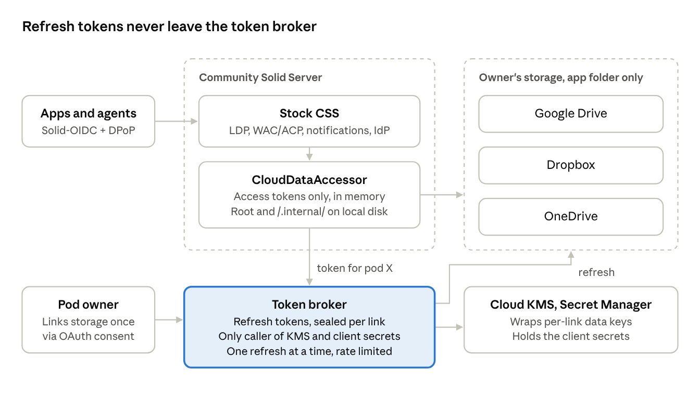

# BYO-Storage Solid Pods on CSS: Token Broker Design

Nov 5, 2026 · Michael Stewart · [live doc](https://claude.ai/artifact/YFDVyZFDa9wjPVXA3ny4db)

Pods run on a stock Community Solid Server (CSS), and their files live in the owner's Google Drive, Dropbox or OneDrive. One custom DataAccessor reads and writes those files. It only ever holds short-lived access tokens. Refresh tokens stay in a separate token broker, wrapped under Cloud KMS.

## At a glance



CSS and its accessor only ever hold hour-long access tokens. Refresh tokens, the KMS wrapping key and the provider client secrets are all behind the broker, in separate services.

## Token broker

The broker is the only component that can turn a stored grant into a working token. It is a small service, roughly 500 lines. It has no public listener except the OAuth callback, and it is the only process allowed to call Cloud KMS and read the provider client secrets.

### Internal API

CSS calls the broker over a private network or a Unix socket, authenticated with mTLS or a static service key. The pod owner's browser reaches only `/link/*/callback`, which CSS forwards unchanged.

| Method and path | Caller | Does |
| --- | --- | --- |
| `POST /links` `{provider, webId, accountId}` | CSS account API | Creates a pending link. Returns the provider's authorize URL, with the broker's own `state` and PKCE verifier kept server-side |
| `GET /link/{provider}/callback?code&state` | User's browser (via CSS) | Exchanges the code with the client secret, wraps the refresh token, marks the link active and redirects back to the account page |
| `POST /links/{linkId}/token` `{podBase}` | CloudDataAccessor | Returns `{accessToken, expiresAt, provider, root}` for that link. Refused unless `podBase` is bound to `linkId` |
| `PUT /pods` `{podBase, linkId}` | CSS pod creation | Binds a pod to a link (one link may hold several pods) |
| `DELETE /links/{linkId}` | Account page, account deletion | Revokes at the provider, destroys the wrapped key and tells CSS to mark the pod offline |
| `GET /links?accountId` | Account page | Lists connected storage: provider, account email, created, last refresh |

The CSS side never sees an authorization code it can use, a refresh token, a client secret or a KMS key. The broker sends the code, the client secret and the PKCE verifier to the provider itself.

### What it stores

One row per link in its own database (SQLite or Postgres, not CSS's `.internal/`):

- `link_id`, `provider`, `provider_account_id`, `account_id`, `status`, `created_at`, `last_refreshed_at`, `version`
- `wrapped_dek`: a per-link 256-bit data key, encrypted by Cloud KMS. The KMS key is restricted to the broker's service account.
- `sealed_refresh`: the refresh token, AES-GCM under that data key, with `link_id` as associated data so a row copied into another link won't decrypt.

A database dump without KMS access is useless. KMS access without the provider client secrets still can't refresh Google, Microsoft or confidential-client Dropbox tokens. The two sit in different services under different IAM roles.

### Refresh rules

- **Access tokens stay in memory.** The broker caches each link's access token until 5 minutes before expiry and never writes it to disk. CloudDataAccessor keeps its own copy for the same window. KMS is called only on an actual refresh, at most about once an hour per active link.
- **One refresh at a time per link.** Concurrent requests for the same link wait on the same promise. This matters most for Microsoft, whose refresh tokens rotate.
- **Persist rotation atomically.** When a provider returns a new refresh token (Microsoft always does), the row is updated with a compare-and-swap on `version` before the new access token is released. The old token is then deleted.
- **Keep Google grants warm.** A Google refresh token dies after 6 months unused, so a daily job refreshes any link idle for more than 30 days.
- **Treat `invalid_grant` as an unlink.** Mark the link `revoked`, return 503 with `Retry-After` from the pod, and email the owner.
- **Rate limits and alerts.** Cap token issuance per link (for example 120 an hour) and per process. Alert when a link's issuance jumps 10× over its 7-day baseline, or when tokens are requested for pods that have had no inbound requests.

### Revocation

On disconnect or account deletion, the broker revokes at the provider first, then crypto-shreds the link by deleting `wrapped_dek`. It deletes the row only after both succeed. Each provider revokes differently; see [Providers](#providers).

### Optional: "only while I'm around" mode

For owners who want it, the data key is wrapped a second time with a key from their passkey (the WebAuthn PRF extension) instead of KMS alone. The broker can unwrap it only during a session where the owner has just signed in. It then holds the unwrapped key in memory for a window the owner picks (for example 7 days). After that, the pod returns 503 to other agents until the next sign-in. A server compromise outside those windows yields nothing for these users.

## CSS wiring

One new component, `CloudDataAccessor`, replaces `FileDataAccessor` inside the stock `DataAccessorBasedStore`. Everything above it stays stock: LDP, WAC/ACP, conneg, notifications, locking and the identity provider. The interface it implements is CSS 7.3's `DataAccessor`: `canHandle`, `getData`, `getMetadata`, `getChildren`, `writeDocument`, `writeContainer`, `writeMetadata`, `deleteResource`.

No changes to CSS itself are needed. See [Upstream changes](#upstream-changes).

### The accessor

```ts
export class CloudDataAccessor implements DataAccessor {
  constructor(
    private readonly fallback: DataAccessor,        // FileDataAccessor: server root, /.internal/, unlinked paths
    private readonly pods: PodLinkIndex,            // podBase -> linkId, longest-prefix match
    private readonly broker: TokenBrokerClient,     // POST /links/{id}/token, in-memory cache
    private readonly adapters: Record<Provider, CloudAdapter>,
    private readonly mapper: CloudPathMapper,       // CSS file layout: $.ext suffixes, .meta, .acl
  ) {}

  async getData(id: ResourceIdentifier) {
    const hit = await this.pods.match(id.path);
    if (!hit) return this.fallback.getData(id);
    const { accessToken, provider, root } = await this.broker.token(hit.linkId, hit.podBase);
    const path = await this.mapper.toCloudPath(id, hit, root);
    return this.adapters[provider].read(accessToken, path);   // NotFoundHttpError on 404
  }
  // getMetadata, getChildren, writeDocument, writeContainer, writeMetadata and deleteResource follow the same shape
}

interface CloudAdapter {
  read(token: string, path: string): Promise<Guarded<Readable>>;
  stat(token: string, path: string): Promise<CloudStat | undefined>;     // size, mtime, version (rev / eTag / Drive version)
  list(token: string, dir: string): AsyncIterable<CloudStat>;
  write(token: string, path: string, data: Readable, ifVersion?: string): Promise<CloudStat>;
  mkdir(token: string, path: string): Promise<void>;
  remove(token: string, path: string, ifVersion?: string): Promise<void>;
}
```

- **Keep the CSS file layout.** `CloudPathMapper` reuses the rules of CSS's `ExtensionBasedMapper`: a `$.ext` suffix when the content type doesn't match the extension, `.meta` files for metadata, `.acl` files as-is. A folder exported from Drive can then be served by a stock CSS with a file backend, which solidshmolid already proves out with `make compat`.
- **Don't let internal data fall through.** The server root, `/.internal/` (accounts, OIDC keys, locks) and anything outside a linked pod go to `fallback`. That is local disk, never a user's cloud.
- **Locking.** CSS's `LockingResourceStore` already serialises `PATCH` read-modify-write per resource. Use the Redis locker once more than one CSS process runs. Pass the version from `stat` as `ifVersion` on writes. Dropbox and OneDrive enforce it. Drive can't, so a check-then-write is the best it gets.
- **Map errors onto Solid status codes.** An expired or invalid grant becomes 503 with `Retry-After`. A provider quota-full error becomes 507. A provider 429 is retried once, honouring `Retry-After`, then passed on as 503.

### components.js

Ship the accessor as an npm package with `lsd:module` and generated components. Then override the backend store in your config, in place of `css:config/storage/backend/file.json`:

```json
{
  "@context": [
    "https://linkedsoftwaredependencies.org/bundles/npm/@solid/community-server/^7.0.0/components/context.jsonld",
    "https://linkedsoftwaredependencies.org/bundles/npm/css-cloud-storage/^0.1.0/components/context.jsonld"
  ],
  "import": ["css:config/storage/backend/data-accessors/file.json"],
  "@graph": [
    {
      "@id": "urn:solid-server:default:ResourceStore_Backend",
      "@type": "DataAccessorBasedStore",
      "identifierStrategy": { "@id": "urn:solid-server:default:IdentifierStrategy" },
      "auxiliaryStrategy": { "@id": "urn:solid-server:default:AuxiliaryStrategy" },
      "metadataStrategy": { "@id": "urn:solid-server:default:MetadataStrategy" },
      "accessor": {
        "@id": "urn:cloud:CloudDataAccessor",
        "@type": "CloudDataAccessor",
        "fallback": { "@id": "urn:solid-server:default:FileDataAccessor" },
        "pods": { "@type": "BrokerPodLinkIndex", "broker": { "@id": "urn:cloud:Broker" } },
        "broker": { "@id": "urn:cloud:Broker", "@type": "TokenBrokerClient", "url": "unix:/run/broker.sock" },
        "adapters_googleDrive": { "@type": "GoogleDriveAdapter" },
        "adapters_dropbox": { "@type": "DropboxAdapter" },
        "adapters_oneDrive": { "@type": "OneDriveAdapter" },
        "mapper": { "@type": "CloudPathMapper" }
      }
    }
  ]
}
```

The `adapters_*` keys are illustrative. Components.js handles a record of adapters awkwardly, so in practice use three named constructor fields or a `ProviderAdapterMap` component.

### Pod creation

CSS's `CreatePodHandler` already passes a free-form `settings` object from the request to the `PodCreator`, and its request schema doesn't strip unknown keys. A client can therefore send `settings.linkId`. A `PodCreator` that wraps the stock `BasePodCreator` reads it and calls the broker's `PUT /pods` before the starter resources are written. Those resources then land in the cloud from the first write.

## Upstream changes

None are required. Two would be nice to propose later:

1. **Pass request conditions to the accessor.** `DataAccessorBasedStore` checks `If-Match` and the version against `getMetadata`, then calls `writeDocument` without the conditions. Inside CSS's lock that's safe. But an edit made directly in Dropbox or OneDrive between those two steps can be overwritten, because the provider never sees the check. Passing the expected version down would let Dropbox and OneDrive enforce it. The workaround is to re-`stat` inside the accessor just before writing.
2. **Clean 503 and 507 errors** for "storage unlinked" and "storage full". The plugin can throw its own `HttpError` subclass today. Check that the error handler passes a custom status code through.

Pin a CSS minor version. The account and pod-creation classes are internal and moved around in v7.

Edits made directly in the provider won't emit Solid notifications, because CSS's activity emitter only fires on writes made through CSS. Covering those means polling each provider's change feed, as solidshmolid does.

## Providers

All three can be scoped to an app-only folder and refreshed only with a client secret. They differ most on rotation, conditional writes and revocation, and those differences are what the broker and adapters have to absorb.

| | Google Drive | Dropbox | OneDrive |
| --- | --- | --- | --- |
| Scope | `drive.file` (only files the app created) | App folder permission, `token_access_type=offline` | `Files.ReadWrite.AppFolder offline_access`, `/drive/special/approot`. POC-verified on personal accounts: root, `Apps/`, writes outside the folder and search are all refused |
| Refresh needs secret | Yes, web clients always | Only if you use the confidential code flow. PKCE-only grants refresh with just the public app key, so use the secret | Yes, as a confidential web client |
| Refresh token lifetime | Dies after 6 months unused. 7 days while the consent screen is in Testing. Max 100 per Google account per client; the oldest is silently dropped | No expiry, no rotation, valid until revoked | 90 days for web apps. Rotates on every refresh, and the old token keeps working ([POC](../poc/onedrive-appfolder/RESULTS.md)), so the broker must persist the new one and delete the old one itself |
| Addressing | By file ID. Keep a path-to-ID index per pod, rebuildable by listing | By path | By path (`approot:/{path}:`) |
| Conditional write | None documented in v3. Check the version, then write, under the CSS lock | `WriteMode.update` with `rev`; set `strict_conflict` so a mismatch is an error | `If-Match` with an eTag or cTag on `PUT /content` and `DELETE` gives 412 on a mismatch (POC-verified). For create-only, use `conflictBehavior=fail` (409); `If-None-Match: *` is ignored |
| Simple upload limit | Use resumable upload above a few MB | 150 MiB, then upload sessions | 250 MB, then upload sessions |
| Revoke | `POST https://oauth2.googleapis.com/revoke` with the token | `POST /2/auth/token/revoke` with a fresh access token; kills the refresh token behind it | No per-grant revoke documented for personal accounts. Delete our copy and send the owner to their Microsoft account's app permissions page |
| Gate before launch | Brand verification. `drive.file` avoids the paid restricted-scope audit | Production approval past 500 users | Publisher verification |

The Google client ID cap matters for testing more than production. One person relinking repeatedly can push out an older link's token, so relinking should replace the old link's row, not add a second one.

## Linking flow

A lay person connects storage once, before their first pod exists, and never sees a token.

1. They sign up through CSS's normal account flow (email and password, or a passkey).
2. The account page shows three buttons: Google Drive, Dropbox, OneDrive. Choosing one calls the broker's `POST /links`, which returns the provider's consent URL.
3. They approve the app-folder permission at the provider. The provider redirects to `/link/{provider}/callback`, which CSS passes straight to the broker.
4. The broker checks `state`, exchanges the code using the client secret, wraps the refresh token under a new KMS-wrapped data key, and redirects back to the account page.
5. They name the pod. CSS's pod creation handler binds `podBase` to the link through `PUT /pods`, then writes the starter profile, `.acl` and containers. These land in the provider folder (for example `Apps/<app>/<pod>/`).
6. From now on, any agent reading the pod goes through CSS, then `CloudDataAccessor`, then a broker-issued access token, then the provider.
7. Disconnect, on the same page, revokes at the provider, shreds the data key and takes the pod offline. The files stay in the owner's storage, in a layout any CSS can serve.

## Implementation (v0.1)

The design is implemented in [`packages/broker`](../packages/broker/) and [`packages/css-cloud-storage`](../packages/css-cloud-storage/). Where the code differs from the plan above:

- **The broker has no public listener at all.** Providers redirect to a CSS page, `/.account/storage/callback/`. Its script posts `code` and `state` to the account API with the visitor's own session, and CSS forwards them with that session's account ID. The broker refuses to finish a link started by a different account. This blocks the attack where someone links their storage to another person's account (or the reverse) by sending them a callback URL.
- **Unlinking keeps the row,** with `status = revoked` and the wrapped key and sealed token set to NULL. The pod's binding stays, so the pod answers 503 instead of reappearing as an empty pod on local disk.
- **503 needs a guard before authorization.** CSS's `UnionPermissionReader` ignores errors from its readers, so a storage error while looking for `.acl` files turns into 401 or 403. `StorageStatusModesExtractor` checks the pod's link first and answers 503.
- **Pod folders.** Each pod lives in `<app folder>/<pod name>/`. Google Drive puts this under a `UbiSolid` folder, because `drive.file` has no app folder.
- **`PodLinkIndex` fails closed.** If the broker can't be reached and nothing is cached, pod requests get 503. Only the server root's own documents and `/.internal/` skip the broker, because those can never be inside a pod.
- **Uploads are buffered** in memory, up to 100 MB. Resumable upload sessions come later.

Tested: 8 broker unit tests; 37 end-to-end checks against the Docker test stack, using a fake provider that rotates refresh tokens like Microsoft; and the adapter conformance suite against the fake provider. None of the three real providers has been run through the plugin yet. Next: `bun test/onedrive-device-token.ts` for a token, then `bun test/adapter-conformance.ts onedrive`.

## Open questions

- [x] Does `Files.ReadWrite.AppFolder` work for personal Microsoft accounts? Yes, and it truly confines the app: see the [OneDrive POC results](../poc/onedrive-appfolder/RESULTS.md).
- [ ] Does the same hold for OneDrive for Business (JMU work accounts)? A JMU app registration is pending IT review. Rerun the [POC](../poc/onedrive-appfolder/) with `MS_AUTHORITY=organizations`.
- [x] Does OneDrive `PUT /content` honour `If-Match`? Yes: 412 on a stale eTag or cTag, for `DELETE` too. `If-None-Match: *` does not work; use `conflictBehavior=fail`.
- [ ] Drive edits made outside the pod, such as a file the owner drops into the folder: with `drive.file` they're invisible. Is that acceptable, or does Drive need a sync-in step like solidshmolid's reconcile?
- [ ] Where does it run? A small GCP VM with Cloud KMS and Secret Manager is enough to start. Check that KMS key access is restricted to the broker's service account only.
- [ ] Is a single CSS process enough to start? If not, add the Redis locker and a shared access-token cache in the broker.
- [ ] Offer the passkey-only mode at launch, or later?
- [ ] Reuse solidshmolid's Dropbox and Drive adapter code (MIT) behind the `CloudAdapter` interface, and coordinate with its author?

## Sources

- [CSS 7.3 DataAccessor interface](https://github.com/CommunitySolidServer/CommunitySolidServer/blob/main/src/storage/accessors/DataAccessor.ts), [file backend config](https://github.com/CommunitySolidServer/CommunitySolidServer/blob/main/config/storage/backend/file.json) and [CreatePodHandler](https://github.com/CommunitySolidServer/CommunitySolidServer/blob/main/src/identity/interaction/pod/CreatePodHandler.ts)
- [solidshmolid](https://github.com/Zamua/solidshmolid) and [its comparison with the original suggestion](https://xfnhtb5y.hostthis.dev/)
- [Google OAuth 2.0: refresh token expiration](https://developers.google.com/identity/protocols/oauth2) and [web server flow and revocation](https://developers.google.com/identity/protocols/oauth2/web-server)
- [Drive API v3 files.update](https://developers.google.com/workspace/drive/api/reference/rest/v3/files/update)
- [Dropbox OAuth guide](https://docs.dropboxapi.com/dropbox-api/docs/oauth), [authorization and refresh](https://docs.dropboxapi.com/dropbox-api/docs/get-started/authorization), [token/revoke](https://docs.dropboxapi.com/dropbox-api/api-reference/user-endpoints/auth/token-revoke) and [files/upload](https://docs.dropboxapi.com/dropbox-api/api-reference/user-endpoints/files/upload.md)
- [Microsoft identity platform refresh tokens](https://learn.microsoft.com/en-us/entra/identity-platform/refresh-tokens), [OneDrive app folder](https://learn.microsoft.com/en-us/onedrive/developer/rest-api/concepts/special-folders-appfolder), [driveItem PUT content](https://learn.microsoft.com/en-us/graph/api/driveitem-put-content), [driveItem update](https://learn.microsoft.com/en-us/graph/api/driveitem-update) and [Graph permissions reference](https://learn.microsoft.com/en-us/graph/permissions-reference)
